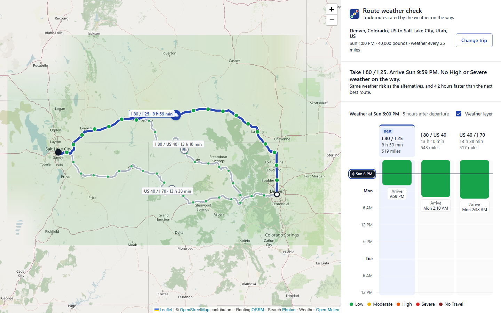

# Weather-Aware Truck Routing


Compare three truck routes by the weather the truck will actually meet. Each route is checked every 10, 25 or 50 miles at the truck's estimated arrival time, rated with the brief's risk and load rules, and ranked so the safest reasonable route comes first.

**Live app:** _link added at deployment_



## Statement

**Who it is for.** Truck dispatchers and drivers planning a trip in the next few days.

**The problem.** A weather forecast for the departure city says little about a 10-hour drive. A truck meets each stretch of road at a different hour, and wind that is merely uncomfortable for a light load can be dangerous for a heavy one. Comparing routes by distance or time alone ignores both.

**The approach.** For three different routes, the app works out when the truck reaches each checkpoint, reads the forecast for that place at that hour, applies the risk and load rules, and ranks the routes by how many miles of serious weather they cross, using time only to break ties. It explains its choice in one sentence and shows the next 48 hours of weather moving along the corridor.

**What it is not.** A decision aid, not a replacement for official weather alerts, road closures, truck restrictions or the driver's judgment. See [Known limitations](#known-limitations).

## Contents

- [Built with](#built-with)
- [Using the app](#using-the-app)
- [Operating framework](#operating-framework)
- [System flow](#system-flow)
- [Requirements coverage](#requirements-coverage)
- [Quick start](#quick-start)
- [Configuration](#configuration)
- [Tests and checks](#tests-and-checks)
- [Deployment](#deployment)
- [Architecture](#architecture)
- [Project structure](#project-structure)
- [Performance](#performance)
- [Known limitations](#known-limitations)
- [Development approach](#development-approach)
- [Further reading](#further-reading)
- [Credits](#credits)

## Built with

| | Tool | Used for |
|---|---|---|
|  | Python 3.11 | Backend language |
|  | Django 5.2 and Django REST Framework | API service |
|  | React 19 | User interface |
|  | Vite 8 | Frontend build and dev server |
|  | Material UI 9 | Form controls and layout |
|  | Leaflet 1.9 and React Leaflet 5 | Interactive map |
|  | OpenStreetMap | Map tiles and road data |
|  | Valhalla | Truck routes and alternatives, using the load weight |
|  | OSRM | Car routes when the truck router cannot answer |
|  | Photon | Place search |
|  | Open-Meteo | Hourly forecasts: wind, rain, snow |
|  | Vitest and Django's test runner | Automated tests |

## Using the app

1. **Enter the trip:** From and To (with suggestions), departure time, load weight, and how often to check the weather (every 10, 25 or 50 miles). Press **Compare routes**.
2. **Read the verdict** at the top of the panel: which route to take, when it arrives, how much serious weather it meets, and why it won.
3. **Compare the routes.** The map shows all three, with the recommended one in blue and a coloured dot at every checkpoint. The schedule shows each route as a lane where time runs downward, coloured by the risk met at each hour.
4. **Look closer.** Click a checkpoint for its distance from the start, ETA, wind, rain and snow, and why it got its level. Hover a lane to circle that spot on the map.
5. **Move through time.** Drag the forecast slider, or the playhead in the schedule, or use the arrow keys. The weather layer and the three trucks on the map move with it, up to 48 hours after departure.
6. **Choose and adjust.** Click a route or lane to select it. Press **Change trip** (or click the trip summary) to change any part of it, including the places, and compare again. **Cancel** returns to the current results.

The full manual, covering each part of the screen, the colours, keyboard controls and every message, is in [docs/user-guide.md](docs/user-guide.md).

## Operating framework

How a dispatch team can use the app in daily work, in five stages:

| Stage | When | What to do |
|---|---|---|
| **1. Plan** | 12 to 48 hours before departure | Enter the real load weight and planned departure. Check every 25 miles for routine trips, every 10 miles in mountains or when storms are forecast. |
| **2. Check** | Right after planning | Read the verdict, then the lanes. Open the coloured checkpoints to see which condition drives the risk and whether the load raised it. |
| **3. Decide** | Before dispatch | Apply the action guide below. If the chosen route shows High or worse, try a later departure with **Change trip** and compare. |
| **4. Brief** | At dispatch | Give the driver the route, the arrival time, and the stretches and hours to watch, read from the schedule. |
| **5. Re-plan** | At departure, when departure slips, and every 6 hours on long trips | Run the trip again with the current time. Forecasts update hourly. |

**Suggested action guide**, based on the worst level on the chosen route. The brief defines the levels; the actions are a starting point for a company's own policy, and the driver's judgment always comes first.

| Worst level on the route | Suggested action |
|---|---|
| Low | Dispatch as planned. |
| Moderate | Dispatch. Brief the driver on where and when. |
| High | Brief the driver. Compare a later departure or another route before dispatching. |
| Severe | Choose a route or departure time without Severe stretches. If there is none, delay. |
| No Travel | Do not dispatch on this route at this time. Delay and re-plan. |

Roles, the weight rules and when to escalate are covered in [docs/operations.md](docs/operations.md).

## System flow

What happens between pressing **Compare routes** and seeing the result:



<sub>Diagram source: [docs/diagrams/system-flow.mmd](docs/diagrams/system-flow.mmd)</sub>

| Stage | What it decides | Detail |
|---|---|---|
| Find places | Where the trip starts and ends | Limited to the US, Canada and Mexico, one connected road network |
| Routes | Three different ways to drive it | Router alternatives, topped up with detours; near-copies removed |
| Checkpoints | Where and when the truck is | Measured along the road; truck speed capped at 65 mph |
| Weather | What the truck meets at each checkpoint | The forecast for the hour the truck is there, not the departure hour |
| Risk | How dangerous each checkpoint is | The worst of wind (after the load rule), rain and snow |
| Rank | Which route is safest | Fewest Severe (or worse) miles, then High miles, then average risk; time breaks ties |
| Present | What the user sees | Verdict, map, schedule, and 49 hourly weather frames built once |

The full logic of each stage is in [docs/architecture.md](docs/architecture.md#4-backend-logic-step-by-step).

## Requirements coverage

| Brief | How it is met | Where |
|---|---|---|
| Origin and destination | Place search with suggestions, or free text geocoded on the server | `frontend/src/features/trip-form`, `backend/routing/geocode.py` |
| Departure date and time | Browser date-time picker, limited to the forecast window (now to 5 days ahead) | `tripRules.js`, `backend/api/serializers.py` |
| Load weight | Pounds, fed into the load rules | `backend/risk/rules.py` |
| 3 route options from a routing API | Router alternatives, topped up with detour routes; near-duplicates removed | `backend/routing/service.py` |
| Weather every 10 / 25 / 50 miles at the truck's ETA | Checkpoints measured along the road; each ETA comes from the driving time to that exact point | `backend/planner/checkpoints.py`, `backend/weather/openmeteo.py` |
| Risk and load rules | Table-driven rules with a test at every boundary | `backend/risk/rules.py`, `backend/tests/test_risk.py` |
| Recommend the best route | Ranked in the brief's order: Severe miles (No Travel counted as Severe or worse), High miles, mile-weighted average risk, time; a one-line reason and a warning if the pick still crosses No Travel | `backend/planner/recommend.py` |
| Routes, checkpoints, risk, ETAs and summaries on a map | Labelled route lines, risk-coloured checkpoints with detail popups, route lanes in the schedule | `frontend/src/features/map`, `frontend/src/features/timeline` |
| Weather heatmap with a 0 to 48 hour slider | Hourly risk grid along the corridor; a 0 to 48 hour slider (and the schedule's playhead) moves the heatmap and the trucks | `backend/planner/heatmap.py`, `frontend/src/features/forecast` |

How the risk boundaries in the brief were read (for example, 0.25 in/hr of rain counts as High) is recorded in [docs/decisions.md](docs/decisions.md#adr-007-reading-the-risk-table).

## Quick start

**Prerequisites:** Python 3.11 or later and Node.js 20.19 or later. No API keys or accounts are needed.

**1. Backend** (Django REST API on port 8000)

```bash
cd backend
python -m venv .venv
source .venv/bin/activate          # Windows PowerShell: .venv\Scripts\Activate.ps1
pip install -r requirements.txt
python manage.py runserver
```

There is no database, so there are no migrations to run.

**2. Frontend** (React app on port 5173)

```bash
cd frontend
npm install
npm run dev
```

Open http://localhost:5173. In development, Vite forwards `/api` to the backend, so no CORS setup is needed.

## Configuration

Both apps run with no configuration. To change a setting, set it as an environment variable or put it in a `.env` file next to the app (never committed).

**Backend (`backend/.env`)**

| Variable | Default | Purpose |
|---|---|---|
| `DJANGO_SECRET_KEY` | development value | Set a real secret in production |
| `DJANGO_DEBUG` | `1` | Set to `0` in production |
| `DJANGO_ALLOWED_HOSTS` | `localhost,127.0.0.1` | Comma-separated host names |
| `CORS_ALLOWED_ORIGINS` | `http://localhost:5173` | Where the frontend is served from |
| `HTTP_USER_AGENT` | `truck-routing-demo/0.1` | Identifies the app to the free routing and search servers, as their policies ask |
| `VALHALLA_URL`, `OSRM_URL`, `PHOTON_URL`, `OPEN_METEO_URL` | public servers | Point at self-hosted instances to remove rate limits |
| `GEOCODE_FALLBACK_URL` | Open-Meteo place search | Used when Photon does not answer |
| `TRUCK_MAX_MPH` | `65` | Speed cap applied to the router's car driving times |

**Frontend (`frontend/.env`)**

| Variable | Default | Purpose |
|---|---|---|
| `VITE_API_URL` | `/api` | Backend base URL when the API is on another host |

## Tests and checks

```bash
cd backend && python manage.py test tests     # 67 tests
cd frontend && npm test                       # 23 tests
cd frontend && npm run lint                   # oxlint
cd backend && ruff check . && ruff format --check .   # needs: pip install -r requirements-dev.txt
```

The backend tests run offline: the API tests replace the routing and weather providers with fixed data, so results never depend on today's weather. They cover every boundary in the risk table, both load rules, the ranking order, checkpoint placement and ETAs, the weather-hour rule, the location budget, the heatmap grid, and the API's 200, 400, 422 and 502 responses. The frontend tests cover form validation, the truck's position along a route, the schedule's time axis and the heatmap colours.

## Deployment

One Docker service on [Render](https://render.com), defined in [`render.yaml`](render.yaml):

1. The [`Dockerfile`](Dockerfile) builds the React app with Node, then runs Django with gunicorn on Python.
2. Django serves the API under `/api` and the built app from the same origin, so no CORS is needed. Hashed script files are cached for a year; the page itself is never cached, so a new deploy shows at once.
3. Render generates `DJANGO_SECRET_KEY`. The service refuses to start in production without one.
4. Render checks `/api/health` before switching traffic to a new deploy.

To deploy your own copy: push the repository to GitHub, then in Render choose **New**, **Blueprint**, and select the repository.

On Render's free plan the service sleeps after about 15 minutes without traffic, and the first request after that takes 30 to 60 seconds while it starts.

## Architecture

A **modular monolith**: one Django service and one React app, each split by capability, with one-way dependencies.



<sub>Diagram source: [docs/diagrams/architecture.mmd](docs/diagrams/architecture.mmd)</sub>

- **`risk`** is pure: the brief's tables as data plus small functions, with no I/O. It is the most heavily tested module.
- **`routing`** and **`weather`** are the only modules that call the outside world; each provider sits behind one small module, so it can be swapped.
- **`planner`** orchestrates one request: routes, then checkpoints, then one batched weather lookup, then risk, then ranking and the heatmap.
- **`api`** only validates input and shapes JSON.
- On the frontend, features never import each other; only `app` combines them. `api` is the only code that talks to the server.

The full request flow, the algorithms and their complexity are in [docs/architecture.md](docs/architecture.md).

## Project structure

```
backend/
  api/         HTTP boundary: request validation, views, JSON shaping
  planner/     one trip end to end: checkpoints, ranking, heatmap
  routing/     place search and routes (Photon, Valhalla, OSRM)
  weather/     hourly forecasts (Open-Meteo), batched and cached
  risk/        the brief's risk and load rules (pure functions)
  common/      geometry helpers and the shared HTTP client
  config/      Django settings and URLs
  tests/       unit and API tests
frontend/src/
  app/         layout, theme and trip state; the only place features meet
  api/         fetch client and endpoint calls
  features/
    trip-form/ inputs, place search, validation rules
    map/       routes, checkpoints, popups
    timeline/  verdict and the hour-by-hour schedule
    forecast/  heatmap frames and moving trucks
  shared/      time, number and risk helpers
docs/          architecture, decisions, API reference
```

## Performance

Measured locally on a typical laptop and home connection:

| What | Result |
|---|---|
| First plan, short trip (Dallas to Houston) | about 5 s, mostly the public routing server |
| First plan, coast to coast, weather every 10 miles | about 10 s |
| Same trip again within 30 minutes | about 0.2 s (cached) |
| Plan response size, gzipped | about 12 to 30 KB (route lines simplified for display) |
| Moving the forecast slider | no network calls; all 49 hourly frames are prepared when the plan arrives |
| JavaScript, gzipped | app code 11 KB; React, MUI and Leaflet in separately cached chunks |

## Known limitations

These are deliberate trade-offs for a free, keyless setup. Each has a known fix.

- **Truck routing up to about 930 miles.** Routes come from Valhalla's truck profile, which avoids roads with weight limits below the load. The public server refuses trips over 1,500 km, so longer trips fall back to OSRM's car routing, and the app says so on screen. Bridge heights and hazmat rules use Valhalla's defaults. Fix: a self-hosted Valhalla with no distance cap.
- **Routes 2 and 3 can be detours.** When the router returns fewer than three alternatives, the extra routes come from side waypoints. They are real roads, but not always the alternatives a dispatcher would choose.
- **No hours-of-service breaks.** ETAs assume continuous driving, so on trips past about 11 hours the truck reaches later checkpoints sooner than a legal schedule would. Fix: insert the 30-minute and 10-hour breaks into the ETA calculation.
- **Free API limits.** Open-Meteo's free tier allows 600 locations a minute and 10,000 a day. One plan is capped at about 300 locations, which also coarsens the weather grid on very long trips. Fix: a paid key or a self-hosted Open-Meteo.
- **Place search fallback is names only.** When Photon does not answer, search falls back to Open-Meteo, which finds cities and towns but not street addresses. Fix: a self-hosted Photon or a keyed geocoder.
- **In-memory cache.** Each server process has its own cache. Fix: switch `CACHES` to Redis when running more than one process.
- **Times are shown in the viewer's time zone**, not the truck's local time along the route.
- **Forecast window.** Departures can be at most 5 days ahead, so the whole trip and the 48-hour window stay inside the 8-day forecast.

## Development approach

Iterative and incremental (agile in practice, not waterfall). The brief fixed the requirements, but the design was not planned up front:

- **Small vertical steps.** The work was split into 15 steps (routes, checkpoints, weather, risk, ranking, heatmap, form, map, forecast, layout, tests, docs, hosting). Each step ended with working, tested code before the next began.
- **The riskiest logic first.** The backend rules and ranking (40 percent of the evaluation) were built and tested before any UI.
- **Tested against real data, then adjusted.** Live runs changed the design several times: the router returning one route led to detours ([ADR-004](docs/decisions.md#adr-004-three-routes-from-alternatives-plus-detours)), a rate-limit error led to the location budget ([ADR-010](docs/decisions.md#adr-010-a-location-budget-per-plan)), and an impossible trip led to the service area ([ADR-013](docs/decisions.md#adr-013-service-area-and-error-codes)).
- **The UI was reviewed after every iteration.** The layout went through four versions before settling on the map plus vertical schedule ([ADR-012](docs/decisions.md#adr-012-map-plus-vertical-schedule)).

## Further reading

- [docs/user-guide.md](docs/user-guide.md): the full user manual
- [docs/operations.md](docs/operations.md): the operating framework for dispatch teams
- [docs/architecture.md](docs/architecture.md): request flow, algorithms and data model
- [docs/decisions.md](docs/decisions.md): architecture decision records, one per significant choice
- [docs/api.md](docs/api.md): endpoints, request and response shapes, errors

## Credits

- Map data © [OpenStreetMap](https://www.openstreetmap.org/copyright) contributors
- Routing by [Valhalla](https://valhalla.github.io/valhalla/) (FOSSGIS public server) and [OSRM](https://project-osrm.org/), place search by [Photon](https://photon.komoot.io/)
- Weather data by [Open-Meteo](https://open-meteo.com/) (CC BY 4.0)
- Truck icon from [Material Icons](https://fonts.google.com/icons) (Apache 2.0)
