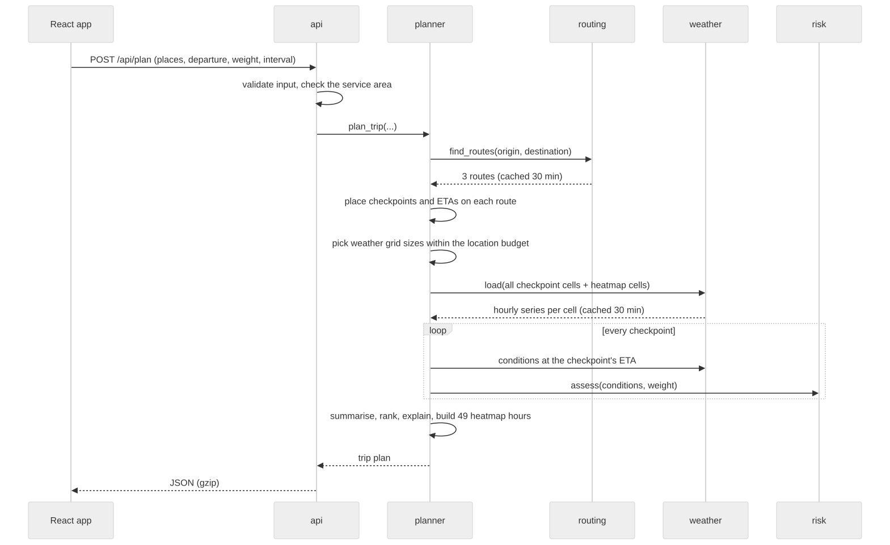

# Architecture

How the system is put together, what happens during one request, and the reasoning behind each algorithm. The choices themselves, with the alternatives that were rejected, are in [decisions.md](decisions.md).

## Contents

1. [Principles](#1-principles)
2. [Modules and dependencies](#2-modules-and-dependencies)
3. [One request, end to end](#3-one-request-end-to-end)
4. [Backend logic, step by step](#4-backend-logic-step-by-step)
5. [Frontend logic](#5-frontend-logic)
6. [Errors and resilience](#6-errors-and-resilience)
7. [Complexity](#7-complexity)
8. [Testing strategy](#8-testing-strategy)
9. [Scaling path](#9-scaling-path)

## 1. Principles

- **One deployable per tier, split by capability.** A modular monolith keeps a 16-hour project simple to run and deploy, while module boundaries keep it easy to change. Each module could become a service later without rewriting its logic.
- **A pure core.** The rules that decide safety (`risk`) and ranking (`planner/recommend.py`) do no I/O. They are plain functions over plain data, so they are fast to test exhaustively.
- **Edges own the outside world.** Only `routing` and `weather` call third-party APIs, each behind one small adapter. Swapping a provider touches one file.
- **One request, one batch.** All weather for a plan (every checkpoint on every route plus the heatmap) is fetched in one batched, cached lookup.
- **Do the work once.** The server returns everything the UI needs for all 48 hours, so scrubbing the forecast never calls the network.

## 2. Modules and dependencies

Diagram source: [diagrams/modules.mmd](diagrams/modules.mmd)

Dependencies point one way. `risk` imports nothing from the project except data types, and nothing imports `api`.

The frontend mirrors this:

| Frontend | Role | Backend counterpart |
|---|---|---|
| `app/` | Layout and state; the only place features are combined | `planner/service.py` |
| `api/` | The only code that calls the server | `api/` |
| `features/*` | One folder per capability; features never import each other | `routing/`, `weather/`, `risk/` |
| `shared/` | Helpers with no feature knowledge | `common/` |

Inside a feature, rules, state and view are separated. For example, the trip form has `tripRules.js` (pure validation), `useTripForm.js` (state and handlers) and `TripForm.jsx` (markup only).

## 3. One request, end to end

Diagram source: [diagrams/request-sequence.mmd](diagrams/request-sequence.mmd)

## 4. Backend logic, step by step

### 4.1 Places (`routing/geocode.py`)

Text is geocoded with Photon, limited to a North America bounding box so suggestions stay on one road network. Duplicate labels (a city and its county) are collapsed. Results are cached for 24 hours. Photon refuses some cloud server addresses, so it gets one try with a 4-second timeout; if that fails, search moves to Open-Meteo's place search for 5 minutes (ADR-015). Any place sent with coordinates is checked against the same service area before routing starts, so an impossible trip fails fast with a field error.

### 4.2 Three routes (`routing/service.py`)

1. Ask Valhalla's truck profile, with the load weight, for up to 3 alternatives. If it fails or the trip is over its 1,500 km limit, ask OSRM's car profile instead, and use the same router for every route of the trip.
2. If fewer than 3 are distinct, request detour routes through side waypoints. A waypoint sits at the trip's midpoint, offset perpendicular to the trip by 8, 15, 30 or 45 percent of its straight-line length, on both sides. Candidates are fetched two at a time, 15 and 8 percent first, stopping once there are 3 routes: the public router answers one request per client at a time, so a bigger batch only queues.
3. Keep a candidate only if it is no slower than 2.5 times the fastest route and shares less than 80 percent of its road with every route already kept. Overlap is measured on sets of coordinates rounded to about 100 m. That rejects near-copies and the out-and-back spurs a waypoint on a dead-end road produces.
4. Take the fastest survivors until there are 3.

Each route keeps its full geometry plus a per-segment distance and duration (OSRM gives these directly; for Valhalla each maneuver's time is spread over its segments by length), so later steps can place points and times anywhere along the road. Routes are named after the two highways they spend the most distance on; when two routes share both, the second name becomes the longest road only that route uses.

### 4.3 Checkpoints and ETAs (`planner/checkpoints.py`)

One linear pass along the road geometry:

- Each segment's drive time is the router's car time, but never faster than the truck speed cap (65 mph by default).
- A checkpoint is placed at mile 0, every 10, 25 or 50 miles, and at the destination. Points inside a segment are interpolated, both for position and for time.
- Each checkpoint **covers** half the distance to each neighbour. Coverage adds up to exactly the trip length, which is what turns checkpoint ratings into "Severe miles" and "High miles".

### 4.4 Weather at the ETA (`weather/openmeteo.py`)

- **Grid.** Each checkpoint is snapped to a grid cell, and all cells across all routes are deduplicated. The grid starts at 0.1 degrees (about 7 miles) and coarsens only when a trip would exceed the location budget (section 4.7).
- **Batching.** Up to 100 cells per request, 4 requests in parallel, asking only for the days the trip needs (up to its last arrival or the end of the 48-hour window; usually 3 of the 8 on offer). Each cell's series is cached for 30 minutes and reused only if it reaches the trip's last hour.
- **Reading a moment.** Wind is interpolated between the two surrounding hours. Rain and snow use the hour the truck is driving through: Open-Meteo stamps each hour's total at the hour's end, so a truck passing at 1:30 reads the 2:00 value. Rain includes showers. Past the end of the forecast, the result is "no forecast", never a guess.

### 4.5 Risk (`risk/rules.py`)

The brief's table is stored as data, one table per condition, listing each level's threshold from worst to mildest. A single `classify()` walks the table. The load rules are a second small table that raises the wind level for heavy loads. A checkpoint's level is the worst of wind (after the load rule), rain and snow. The function also reports each condition's level and whether the load raised it, which the UI uses to explain a rating.

For the heatmap, `intensity()` returns the same scale as a continuous number from 0 to 4 (40 mph wind is 2.5, halfway through High), capped so a value never shows the next level early.

### 4.6 Ranking (`planner/recommend.py`)

Each route gets miles per level, a mile-weighted average risk and its drive time. Routes are sorted by one key, in this order:

1. Severe or worse miles (Severe plus No Travel)
2. High miles
3. Average risk
4. Drive time

Values are rounded before comparing, so floating-point noise never decides a winner. The reason line names the first rule in that order where the winner beat the runner-up. No Travel miles count toward Severe miles, since No Travel is worse. If the recommended route still crosses No Travel, or every route does, the response warns that a later departure may be safer.

### 4.7 Heatmap and the location budget (`planner/heatmap.py`, `planner/service.py`)

Open-Meteo's free tier allows 600 locations a minute, so one plan is held to about 300:

- **Checkpoints:** at most 200 cells. The finest grid size from 0.1 to 1.0 degrees that fits is chosen.
- **Heatmap:** at most 100 cells. Each route is sampled every 15 miles and the 3 by 3 block of cells around each sample is taken, at the finest size from 0.3 to 3 degrees that fits.

The heatmap response is the cell list plus 49 rows (hours 0 to 48 after departure) of 0 to 4 intensities.

### 4.8 Response shaping (`api/presenters.py`)

Route lines are simplified for display with Douglas-Peucker (about 50 m tolerance, implemented with a stack instead of recursion). That cuts a 1,000-mile route from about 10,000 points to about 600, while checkpoints and ETAs still use the full geometry. Numbers are rounded, and responses are gzipped. A typical plan is 12 to 30 KB on the wire.

## 5. Frontend logic

### 5.1 State

- `app/useTripPlan.js` holds the plan, the selected route and the request state. A failed request clears the old plan, so results never sit under inputs they don't belong to.
- `features/forecast/useForecast.js` holds the forecast hour and the layer toggle, and prepares everything the hour drives (heatmap frames and truck tracks) once per plan.

### 5.2 Heatmap frames (`features/forecast/heatFrames.js`)

Each hour becomes a tiny image with one pixel per grid cell, coloured with the risk palette and made more opaque as risk rises. The browser stretches it over the corridor with smooth scaling, which gives a soft gradient while keeping each cell's value exact. All 49 frames are built once, in a few milliseconds, so moving the slider only swaps an image. A density heatmap library was rejected because overlapping points add up, which would make a calm corridor look stormy.

### 5.3 Moving trucks (`features/forecast/truckPosition.js`)

For a given time, the truck's mile comes from the two checkpoint ETAs around it. Its position comes from walking the route line to that mile, found with a binary search over cumulative distances, so the truck follows the road instead of cutting corners.

### 5.4 The schedule (`features/timeline/`)

- Each route is a lane, and time runs downward. Each checkpoint owns the time halfway to its neighbours, and neighbouring stretches with the same level are merged into one block, which leaves fewer elements and no seams.
- The axis spans 48 hours, or the longest drive rounded up to 6 hours when a trip runs longer. Ticks fall on 6 AM, 12 PM and 6 PM, with day names at midnight.
- The playhead is an accessible slider (`role="slider"`, arrow, page and home or end keys) limited to the 48-hour forecast window. Dragging anywhere in the lanes moves it, and hovering a lane circles that checkpoint on the map.

### 5.5 Map framing (`features/map/TripMap.jsx`)

The map fits all routes when a plan arrives, and again whenever its own size changes (for example on window resize), until the user pans or zooms. After that, the user's view wins.

## 6. Errors and resilience

| Situation | What happens | Status |
|---|---|---|
| Invalid input (missing field, departure outside the window, interval not 10, 25 or 50) | Field errors shown under the matching inputs | 400 |
| Place outside the service area, or not found | Field error under From or To; no routing call is made | 400 |
| No road connects the places (for example Hawaii to Arizona) | Plain message; this is the user's input, not a server fault | 422 |
| Provider busy, down or slow | Retried after 1 s and 3 s, then a plain "try again" message | 502 |

Provider error messages never include request URLs. Weather that runs past the forecast is shown as "no forecast" and kept out of averages, and the response says so.

## 7. Complexity

`n` = route geometry points, `c` = checkpoints, `g` = heatmap cells.

| Step | Cost |
|---|---|
| Checkpoint placement | O(n) per route, one pass |
| Route overlap check | O(n) per pair with hash sets |
| Weather lookups | O(c + g) cells, batched 100 per request |
| Risk and ranking | O(c), then sorting 3 routes |
| Heatmap values | O(49 g) |
| Line simplification | O(n log n) typical, O(n²) worst case |
| Truck position per frame | O(log n) binary search |

## 8. Testing strategy

- **The pure core is tested exhaustively:** every boundary in the risk table, both load rules at and just above their limits, the ranking order rule by rule, and coverage summing to the trip length.
- **Providers are mocked in API tests**, so the suite runs offline and deterministically. Real-provider behaviour (alternatives, rate limits, units) was checked manually during development, and the findings are recorded in the decisions.
- **Frontend logic is unit-tested without rendering:** form rules, the schedule axis, truck position and heatmap colours.

## 9. Scaling path

What would change, in order, if this served many users:

1. **Redis** for the cache (one setting), shared across processes.
2. **Self-hosted Valhalla**, plus Photon and Open-Meteo instances. This removes the rate limits and the 1,500 km cap on truck routing.
3. **A tile provider or tile server** instead of the public OpenStreetMap tiles, whose usage policy is meant for light use.
4. **A background job queue** for very long trips, returning a plan ID the UI polls.
5. **A precomputed national weather grid** refreshed hourly, so plans read from storage instead of calling the forecast API per request.
