# Operating framework

How a dispatch team can use the app in daily work: who does what, when to plan, how to decide, and what to do when the answer is "not now". For the screen itself, see the [user guide](user-guide.md).

> The brief defines the risk levels. The actions here are a suggested starting point for a company's own safety policy. Official weather alerts, road closures, truck restrictions, hours-of-service rules and the driver's judgment always come first.

## Contents

1. [Roles](#1-roles)
2. [The cycle](#2-the-cycle)
3. [Plan and check](#3-plan-and-check)
4. [Decide](#4-decide)
5. [Brief](#5-brief)
6. [Re-plan](#6-re-plan)
7. [Load weight and wind](#7-load-weight-and-wind)
8. [When the app cannot answer](#8-when-the-app-cannot-answer)
9. [Outside the app's scope](#9-outside-the-apps-scope)

## 1. Roles

| Role | Responsibility |
|---|---|
| **Dispatcher** | Plans the trip, applies the action guide, briefs the driver, re-plans when things change |
| **Driver** | Receives the brief, watches the flagged stretches, reports conditions that differ from the forecast, and can stop when unsafe, whatever the plan says |
| **Safety or operations lead** | Owns the action guide, decides company-specific thresholds, and reviews decisions made at High or worse |

## 2. The cycle

Diagram source: [diagrams/operating-cycle.mmd](diagrams/operating-cycle.mmd)

## 3. Plan and check

**Plan** 12 to 48 hours before departure, when forecasts are useful but there is still time to change the plan.

- Enter the **real** load weight and the **planned** departure time. Both change the result.
- Choose the check spacing:
  - **25 miles** for routine trips;
  - **10 miles** in mountains, on coasts, or when storms are forecast;
  - **50 miles** to screen a long haul quickly before a closer look.

**Check** the result in this order:

1. **The verdict:** the recommended route and the deciding rule.
2. **The lanes:** where and when colour appears on each route.
3. **The coloured checkpoints:** open them to see which condition drives the risk (wind, rain or snow) and whether the load raised it.
4. **The playhead:** drag through the trip to see whether weather is moving toward or away from the truck.

## 4. Decide

Use the **worst level on the route you intend to dispatch**:

| Worst level | Suggested action | Record |
|---|---|---|
| **Low** | Dispatch as planned. | Not needed |
| **Moderate** | Dispatch. Brief the driver on where and when. | Not needed |
| **High** | Brief the driver. Before dispatching, compare a later departure (3 or 6 hours later) and the next-ranked route. | Note the choice and why |
| **Severe** | Choose a route or departure time without Severe stretches. If there is none, delay. | Note it; tell the operations lead |
| **No Travel** | Do not dispatch on this route at this time. Delay and re-plan. | Note it; tell the operations lead |

**Trying a later departure:** press **Change trip**, change only the departure, and compare. Weather moves, so a delay of a few hours often turns a Severe stretch into a Moderate one.

**Choosing a route other than the recommendation** is fine when there is a reason the app cannot see (a customer window, a known closure, a driver's experience with a road). Record the reason.

## 5. Brief

Give the driver, from the screen:

- the **route** (its main highways) and the **arrival time**;
- each **stretch to watch**: the hour, the place (from the checkpoint popup) and the condition, for example *"High wind near mile 180, around 3 PM, raised because of the load"*;
- the **plan B**: the next-ranked route, and when the trip will be re-planned.

## 6. Re-plan

Run the trip again:

- **at departure**, with the actual departure time;
- **whenever departure slips** by an hour or more;
- **every 6 hours on long trips**, or at planned stops;
- **when the driver reports** conditions different from the forecast.

Forecasts update about every hour. The app caches lookups for 30 minutes, so re-planning sooner than that shows the same result.

## 7. Load weight and wind

The same wind is more dangerous for a heavier load:

| Wind | Up to 30,000 lb | 30,001 to 40,000 lb | Over 40,000 lb |
|---|---|---|---|
| 35 to 44 mph | High | High | **Severe** |
| 45 to 54 mph | Severe | **No Travel** | **No Travel** |
| 55 mph or more | No Travel | No Travel | No Travel |

When wind drives the risk and the load is near a limit, splitting or lightening the load can change the decision. Re-run the trip with the new weight to confirm.

## 8. When the app cannot answer

| Situation | What to do |
|---|---|
| **Every route shows No Travel** (the app warns) | Hold the load. Re-plan with later departures until a route clears. |
| **"Busy, try again in a minute"** | Wait a minute and retry. If it persists, use official forecasts and alerts directly. |
| **Part of the trip is beyond the forecast** | Those miles are not rated. Plan again closer to departure. |
| **The app is unavailable** | Use official forecasts and alerts, and apply the same action guide by hand. |

## 9. Outside the app's scope

Check these separately on every trip; the app does not cover them:

- official weather alerts and warnings;
- road closures, construction and chain requirements;
- truck restrictions: bridge heights, weight limits, hazmat routes;
- border crossings (the free router may route through Canada);
- hours-of-service rules and rest stops (ETAs assume continuous driving).

The app does not store trips. Record decisions in the dispatch system or log.
